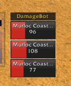
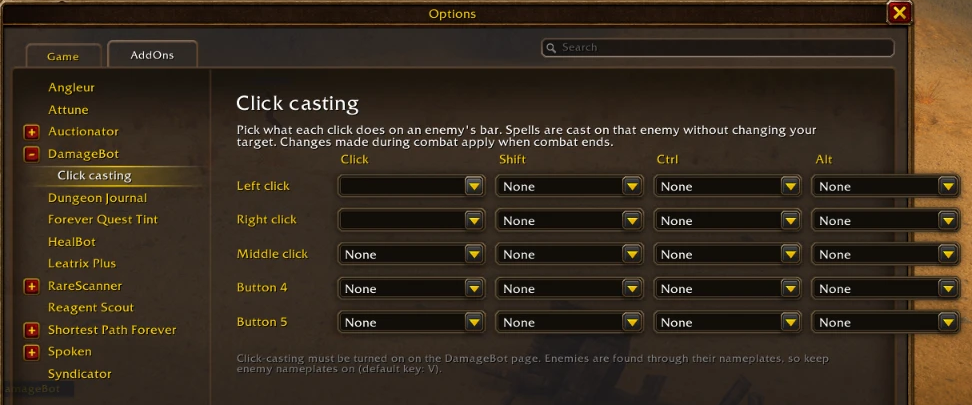

# WoW Forever Addons

Three addons for the **WoW Forever** client (interface 16001), which runs Classic Era items
and zones on a modern game client.

| Addon | What it does |
|---|---|
| [Reagent Scout](#reagent-scout) | Shows the vendor price of each reagent, and where the nearest vendor is, in the profession window |
| [DamageBot](#damagebot) | HealBot-style bars for the enemies you're fighting, with your DoTs on each one |
| [Disenchant Odds](#disenchant-odds) | Shows what an item disenchants into, and the chance of each result, in its tooltip |

## Install

1. Click **Code > Download ZIP** above and unzip it.
2. Copy the addon folders you want (`ReagentScout`, `DamageBot`, `DisenchantOdds`) into
   `World of Warcraft\_forever_\Interface\AddOns\`. Each folder must contain its `.toc` file directly.
3. Restart the game (a `/reload` isn't enough for a new addon) and tick the addons at character select.

---

## Reagent Scout

When you select a recipe in a profession window, each reagent you can buy from a vendor gets
a small line under it with its **price** and the **zone of the nearest vendor**, for example
`35c - Elwynn Forest`. So you don't get sent to some odd vendor across the world.

- The zone is **green** when the vendor is close (under 300 yards), **yellow** within 1,500 yards,
  and **gray** when it's farther.
- **Hover** the line to see the nearest vendors grouped by zone; **click** it to set a waypoint
  (TomTom if you have it, otherwise the game's own map pin).
- Vendor locations are built in (94 reagents, 333 vendors, from QuestieDB's Forever data). Prices
  are learned as you visit vendors: the game only reveals a vendor's prices when you open it.
- Settings: `/rscout`. Help: `/rscout status`, `/rscout debug`.

## DamageBot

Like HealBot, but for enemies. Every enemy in combat with you gets a bar with its name and
health, and **your DoTs on it appear as small icons in the bottom-right corner**, with a timer
swipe, the way HealBot shows your HoTs.



- **Mouseover cast:** hover an enemy's bar and press your normal spell key; the spell goes to
  that enemy without changing your target. (DamageBot turns on the game's own Mouseover Cast
  setting for this; untick "Mouseover cast" in `/dbot` to turn it off.)
- **Click bindings:** pick an action for each mouse button, plain or with Shift, Ctrl or Alt.
  Saved per character.



- Only enemies fighting you (or your party) are listed. Enemies are found through their
  nameplates, so keep enemy nameplates on (default key: V).
- `/dbot test` shows sample bars so you can drag them into place; `/dbot` opens the settings.

**Forever limits:** in combat Forever hides enemy debuffs from addons, so DamageBot borrows
the debuff icons from each enemy's nameplate and moves them onto its bar. Forever may also
block clicks that cast a spell through a nameplate ("Interface action failed"); mouseover
casting is the reliable way to cast from the bars.

## Disenchant Odds

Hover any green, blue or purple weapon or armor and the tooltip shows what it disenchants into:

```
Disenchants into:              Enchanting 150
  [icon] 1-2x Dream Dust                  75%
  [icon] 1-2x Greater Nether Essence      20%
  [icon] 1x Large Radiant Shard            5%
  Average value (Auctionator)         1g 20s
```

- Armor gives mostly dust and weapons mostly essences; blues give shards (with a small Nexus
  Crystal chance from item level 56), purples give shards or Nexus Crystals.
- The **Enchanting skill needed** is green when yours is high enough, red when it isn't, and gray
  on characters without Enchanting.
- With **Auctionator** installed, it also shows the average auction value of the results.
- Settings: `/deodds`. You can show the lines only while holding Shift, or only on your enchanters.
- Numbers come from the Classic Era disenchanting tables
  ([warcraft.wiki.gg](https://warcraft.wiki.gg/wiki/Disenchanting_tables)). If Forever changes
  its disenchant rules, real results can differ.

---

## License

GNU General Public License v3 (see [LICENSE](LICENSE)). Reagent Scout's `Data.lua` is extracted
from [QuestieDB](https://github.com/Questie/QuestieDB), which is GPLv3, so the collection is
GPLv3 as well.
